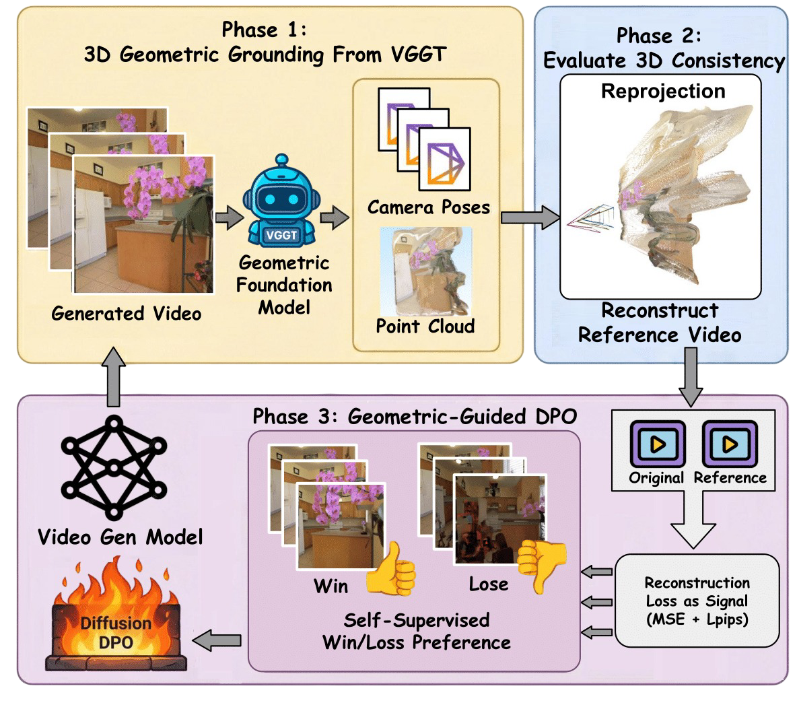
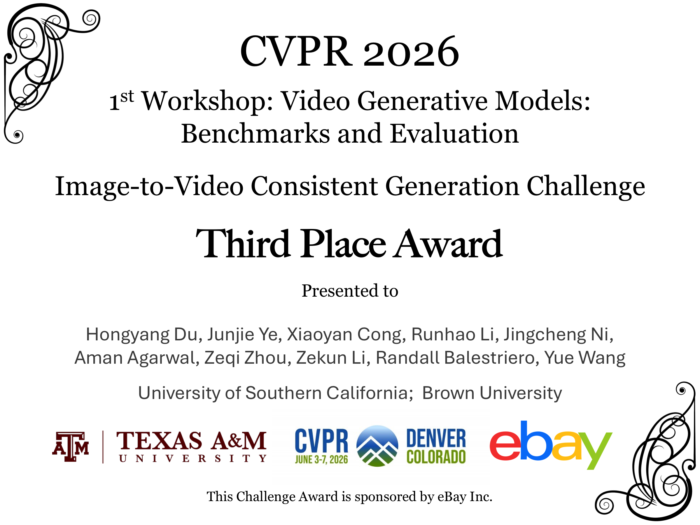

<div align="center">

# VideoGPA: Distilling Geometry Priors for 3D-Consistent Video Generation

[**Hongyang Du**](https://hongyang-du.github.io/)<sup>*1,2</sup>  · [**Junjie Ye**](https://junjieye.com/)<sup>*1</sup>· [**Xiaoyan Cong**](https://oliver-cong02.github.io/)<sup>*2</sup> · [**Runhao Li**](https://github.com/runhaoli-creator)<sup>1</sup> · [**Jingcheng Ni**](https://jingchengni.com/)<sup>2</sup>  
[**Aman Agarwal**](https://aman190202.github.io)<sup>2</sup>  · **Zeqi Zhou**<sup>2</sup> · [**Zekun Li**](https://kunkun0w0.github.io/)<sup>2</sup>  · [**Randall Balestriero**](https://randallbalestriero.github.io/)<sup>2</sup> · [**Yue Wang**](https://yuewang.xyz/)<sup>1</sup>

<sup>1</sup>Physical SuperIntelligence Lab, University of Southern California 
<br> 
<sup>2</sup>Department of Computer Science, Brown University 
<br>
<sup>*</sup> Equal Contribution

<a href='https://arxiv.org/abs/2601.23286'></a>
<a href='https://hongyang-du.github.io/VideoGPA-Website/'></a>
[](https://opensource.org/licenses/MIT)

</div>

<div align="center">
  
</div>


## 🔥 News
- [x] 🏆 **VideoGPA(Wan2.2-TI2V-5B Base Model)** won 🥉 place in the eBay-sponsored **Image-to-Video Consistent Generation Challenge** at CVPR 2026 VGBE Workshop

<div align="center">
  
</div>

- [x] We release the **VideoGPA-Wan2.2-TI2V DPO LoRA** checkpoint! Download via `python download_ckpt.py ti2v` and generate with [`generate/Wan2.2-TI2V-5B.py`](generate/Wan2.2-TI2V-5B.py).
- [x] We release **VideoGPA-I2V-1K** — we find that only **1,000 steps** already achieves surprisingly strong visual quality and benchmark scores. We're releasing it so everyone can play around with it! Download via `python download_ckpt.py i2v-1k`.
- [x] We release our **DL3DV video captions** generated with CogVLM. Check them out in [`dl3dv_video_captions`](dl3dv_video_captions).
- [x] We release the training code for **Wan2.2-TI2V-5B**! Check it out in [`train/Wan2.2-TI2V-5B`](train/Wan2.2-TI2V-5B).


# Quick Start

## 📋 Requirements

Python 3.10 – 3.12.

```bash
pip install -r requirements.txt
```

## 🔘 Checkpoint Download

```bash
# Download all VideoGPA LoRA checkpoints
python download_ckpt.py all

# Or download specific ones
python download_ckpt.py i2v      # CogVideoX-I2V-5B
python download_ckpt.py i2v-1k   # CogVideoX-I2V-5B (1K steps, lightweight)
python download_ckpt.py t2v      # CogVideoX-5B
python download_ckpt.py t2v15    # CogVideoX1.5-5B
python download_ckpt.py ti2v     # Wan2.2-TI2V-5B
```

```
checkpoints/
├── VideoGPA-I2V-lora/
│   └── adapter_model.safetensors
├── VideoGPA-I2V-1K-lora/
│   └── adapter_model.safetensors
├── VideoGPA-T2V-lora/
│   └── adapter_model.safetensors
├── VideoGPA-T2V1.5-lora/
│   └── adapter_model.safetensors
└── VideoGPA-Wan2.2TI2V-lora/
    └── adapter_model.safetensors
```

## 🎬 Video Generation

All scripts share the same interface: `--prompt_json` (required), `--output_dir` (required), `--lora_path` (optional for DPO), `--gpu_id`, `--seed`.

### CogVideoX-5B Text-to-Video

```bash
# Baseline (no LoRA)
python generate/CogVideoX-5B.py \
    --prompt_json prompts.json \
    --output_dir outputs/t2v_baseline

# With VideoGPA DPO LoRA
python generate/CogVideoX-5B.py \
    --prompt_json prompts.json \
    --output_dir outputs/t2v_dpo \
    --lora_path checkpoints/VideoGPA-T2V-lora
```

### CogVideoX-5B Image-to-Video

```bash
# Baseline
python generate/CogVideoX-5B-I2V.py \
    --prompt_json prompts.json \
    --output_dir outputs/i2v_baseline

# With VideoGPA DPO LoRA
python generate/CogVideoX-5B-I2V.py \
    --prompt_json prompts.json \
    --output_dir outputs/i2v_dpo \
    --lora_path checkpoints/VideoGPA-I2V-lora

# With VideoGPA-I2V-1K LoRA (lightweight, 1K steps)
python generate/CogVideoX-5B-I2V.py \
    --prompt_json prompts.json \
    --output_dir outputs/i2v_1k \
    --lora_path checkpoints/VideoGPA-I2V-1K-lora
```

### CogVideoX1.5-5B Text-to-Video

```bash
# Baseline
python generate/CogVideoX1.5-5B.py \
    --prompt_json prompts.json \
    --output_dir outputs/t2v15_baseline

# With VideoGPA DPO LoRA
python generate/CogVideoX1.5-5B.py \
    --prompt_json prompts.json \
    --output_dir outputs/t2v15_dpo \
    --lora_path checkpoints/VideoGPA-T2V1.5-lora
```

### Wan2.2-TI2V-5B Text-Image-to-Video

Unlike the CogVideoX scripts, `generate/Wan2.2-TI2V-5B.py` requires `--model_path` pointing to the base [Wan2.2-TI2V-5B](https://huggingface.co/Wan-AI/Wan2.2-TI2V-5B) weights.

```bash
# Baseline
python generate/Wan2.2-TI2V-5B.py \
    --model_path /path/to/Wan2.2-TI2V-5B \
    --prompt_json prompts.json \
    --output_dir outputs/ti2v_baseline

# With VideoGPA DPO LoRA (LoRA strength defaults to --lora_weight 0.2)
python generate/Wan2.2-TI2V-5B.py \
    --model_path /path/to/Wan2.2-TI2V-5B \
    --prompt_json prompts.json \
    --output_dir outputs/ti2v_dpo \
    --lora_path checkpoints/VideoGPA-Wan2.2TI2V-lora
```

> **LoRA strength:** both `Wan2.2-TI2V-5B.py` and `CogVideoX1.5-5B.py` apply the LoRA at `--lora_weight 0.2` by default. Pass a different value to tune it.

### Common Arguments

| Argument | Description | Default |
|---|---|---|
| `--prompt_json` | JSON file with prompts (required) | — |
| `--output_dir` | Output directory (required) | — |
| `--lora_path` | Path to LoRA adapter | `None` |
| `--gpu_id` | GPU device ID | `0` |
| `--seed` | Random seed | `42` |
| `--num_prompts` | Limit number of prompts | all |

### Prompt JSON Format

```json
{
  "scene_001": {"text_prompt": "Camera pans left", "image_prompt": "/path/to/frame.png"},
  "scene_002": {"text_prompt": "Zoom into the building", "image_prompt": "/path/to/frame2.png"}
}
```

For T2V, `image_prompt` can be omitted. See `data_prep/generate_i2v_prompts.py` to auto-generate prompts from a folder of first frames.

## 📁 Code Structure

```
VideoGPA/
├── generate/                    # Video generation scripts
│   ├── CogVideoX-5B.py              # T2V
│   ├── CogVideoX-5B-I2V.py          # I2V
│   ├── CogVideoX1.5-5B.py           # T2V 1.5
│   └── Wan2.2-TI2V-5B.py            # Wan TI2V
├── train/                       # DPO training pipeline
│   ├── 01_preference_pair.py        # Video scoring
│   ├── dataset.py                   # DPO dataset (CogVideo + Wan)
│   ├── loss.py                      # DPO loss
│   ├── CogVideoX-5B/                # encode & train
│   ├── CogVideoX-I2V-5B/            # encode & train
│   ├── CogVideoX1.5-5B/             # encode & train
│   └── Wan2.2-TI2V-5B/              # encode & train
├── dl3dv_video_captions/        # Benchmark captions (1K / 8K / 9K / 10K / 11K)
├── data_prep/                   # Scripts to prepare prompt JSONs
├── checkpoints/                 # VideoGPA LoRA weights
├── metrics/                     # Evaluation metrics (MSE, SSIM, LPIPS, epipolar, …)
├── pipelines/                   # Shared video processing pipeline
├── utils/                       # Utility functions
├── replicate.py                 # Multi-GPU I2V generation for benchmarking
├── replicate_scorer.py          # Multi-GPU DA3 scoring
└── replicate.sh                 # End-to-end generation + scoring script
```

## 🔧 DPO Training

VideoGPA uses DPO (Direct Preference Optimization) to improve 3D consistency in video generation. The training pipeline has 3 steps:

#### Step 1: Score Generated Videos
```bash
python train/01_preference_pair.py
```

#### Step 2: Encode Videos to Latent Space
```bash
# CogVideoX models
python train/CogVideoX-I2V-5B/02_encode.py
python train/CogVideoX-5B/02_encode.py
python train/CogVideoX1.5-5B/02_encode.py

# Wan2.2 (requires --base_path and --model_path)
python train/Wan2.2-TI2V-5B/02_encode.py \
    --base_path /path/to/dataset \
    --model_path /path/to/Wan2.2-TI2V-5B \
    --input_json /path/to/scored.json \
    --output_json /path/to/encoded.json
```

#### Step 3: Run DPO Training
```bash
# CogVideoX models
python train/CogVideoX-I2V-5B/03_train.py --base_path /path/to/dataset
python train/CogVideoX-5B/03_train.py --base_path /path/to/dataset
python train/CogVideoX1.5-5B/03_train.py --base_path /path/to/dataset

# Wan2.2
python train/Wan2.2-TI2V-5B/03_train.py \
    --base_path /path/to/dataset \
    --model_path /path/to/Wan2.2-TI2V-5B
```

**Shared components** (`train/dataset.py`, `train/loss.py`) work across all models — CogVideoX uses v-prediction, Wan uses flow matching, but the DPO loss operates on model-agnostic (prediction, target) pairs.

**Data Format:** Training requires JSON metadata with preference pairs. See [dataset.py](train/dataset.py) for the expected format.


## 📊 Benchmark Replication

`replicate.sh` runs generation and scoring end-to-end. Requires [DL3DV-10K](https://dl3dv-10k.github.io/DL3DV-10K/) first frames; text captions are provided in `dl3dv_video_captions/captions_1K.json`.

```bash
bash replicate.sh \
  --dl3dv_dir /path/to/DL3DV-10K \
  --lora_path checkpoints/VideoGPA-I2V-lora \
  --output_dir output/i2v_dpo \
  --devices 0,1,2,3,4,5,6,7
```

Scores are saved to `<output_dir>/scores.csv`. Run `bash replicate.sh --help` for all options.

> **Note:** Scores may differ slightly from the paper due to non-deterministic CUDA operators in inference and hardware variation across machines.

## 🙏 Acknowledgements

We would like to express our gratitude to the following projects and researchers:

* **[CogVideoX](https://github.com/zai-org/CogVideo)** - Text/Image-to-video generation model.
* **[Wan2.2](https://github.com/Wan-Video/Wan2.2)** - State-of-the-art video generation model.
* **[PEFT](https://github.com/huggingface/peft)** - Parameter-efficient fine-tuning with LoRA.
* **[Diffusion DPO](https://github.com/SalesforceAIResearch/DiffusionDPO)** - Direct Preference Optimization in the diffusion latent space.

Thanks to **[Dawei Liu](https://github.com/davidliuk)** for the amazing website design!
## 🌟 Citation

```bibtex
@InProceedings{pmlr-v306-du26q,
  title = 	 {{V}ideo{GPA}: Distilling Geometry Priors for 3{D}-Consistent Video Generation},
  author =       {Du, Hongyang and Ye, Junjie and Cong, Xiaoyan and Li, Runhao and Ni, Jingcheng and Agarwal, Aman and Zhou, Zeqi and Li, Zekun and Balestriero, Randall and Wang, Yue},
  booktitle = 	 {Proceedings of the 43rd International Conference on Machine Learning},
  pages = 	 {26797--26832},
  year = 	 {2026},
  editor = 	 {Zhang, Tong and Dudik, Miroslav and Jaggi, Martin and Agarwal, Alekh and Li, Sharon and Schuurmans, Dale and Zhu, Jerry and Berkenkamp, Felix and Dong, Hanze and Bietti, Alberto},
  volume = 	 {306},
  series = 	 {Proceedings of Machine Learning Research},
  month = 	 {06--11 Jul},
  publisher =    {PMLR},
  pdf = 	 {https://raw.githubusercontent.com/mlresearch/v306/main/assets/du26q/du26q.pdf},
  url = 	 {https://proceedings.mlr.press/v306/du26q.html},
  abstract = 	 {While recent video diffusion models (VDMs) produce visually impressive results, they fundamentally struggle to maintain 3D structural consistency, often resulting in object deformation or spatial drift. We hypothesize that these failures arise because standard denoising objectives lack explicit incentives for geometric coherence. To address this, we introduce VideoGPA (Video Geometric Preference Alignment), a data-efficient self-supervised framework that leverages a geometry foundation model to automatically derive dense preference signals that guide VDMs via Direct Preference Optimization (DPO). This approach effectively steers the generative distribution toward inherent 3D consistency without requiring human annotations. VideoGPA significantly enhances temporal stability, geometric plausibility, and motion coherence using minimal preference pairs, consistently outperforming state-of-the-art baselines in extensive experiments.}
}

```
